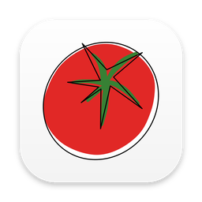

# Tomatime



A menu-bar focus timer for macOS. Pick a tomato, focus, then actually take the break.

- Green 20 min · Red 25 min · Golden 45 min · Diamond 60 min, or type your own length (up to 8 hours), solo or for a group.
- When time's up, a pulsing red screen covers every display until you choose: 5 min break then
  next session (Return), a 5 or 10 minute break, or 1 more minute.
- Exam mode: tomatoes and breaks back to back, alone or with a group (25 · 60 · 45 · 45 minutes with 8, 10 and
  20 minute breaks, or your own plan). Why that plan: [docs/exam-mode-science.md](docs/exam-mode-science.md).
- In a group, anyone in a group tomato can change its length, or pick a different tomato for the next round.
- Counts your tomato minutes for the day (actual focus time; breaks, pauses and sleep don't count).
- Tomato Calendar: a month view with each day shaded by its tomato minutes.
- Open at Login, Reduce Motion support, no data collected.

## Build

Needs macOS 14+, Xcode and [XcodeGen](https://github.com/yonaskolb/XcodeGen) (`brew install xcodegen`).

```sh
tools/run-local.sh          # build, install to ~/Applications, launch
tools/run-local.sh --fast   # every "minute" is one second, for testing
```

`tools/release.sh` builds the signed Mac App Store package; it needs the author's certificates.

## Windows

`windows/` is Tomatime for Windows (Electron): the same timer in the tray by the clock, and Tomatime Groups with the
same countdown, group tomato, red end screen and group break as on the Mac. People join with an invite code and a
name; people who use Tomatime on an iPhone, Apple Watch or Mac can sign in with Apple, and the PC follows the same timer.

```sh
cd windows && npm install
npm start                     # needs windows/firebase-config.json (not in the repo), else it is the solo timer
tools/test-windows.sh         # from the repo root: rules, Groups against the Firebase emulators, the windows (hidden)
npm run dist                  # the installer: windows/dist/Tomatime-Setup-<version>.exe
```

`rules.js` mirrors `Groups/GroupRules.swift` and `Shared/TomatoTimer.swift`: change a rule in both.

## License

MIT
