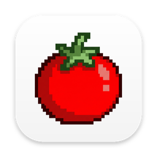

# Tomatime



A menu-bar focus timer for macOS. Pick a tomato, focus, then actually take the break.

- Green 20 min · Red 25 min · Golden 45 min · Diamond 60 min. Focus never runs past an hour.
- When time's up, a pulsing red screen covers every display until you choose: 5 min break then
  next session (Return), a 5 or 10 minute break, or 1 more minute.
- Open at Login, Reduce Motion support, no data collected.

## Build

Needs macOS 14+, Xcode and [XcodeGen](https://github.com/yonaskolb/XcodeGen) (`brew install xcodegen`).

```sh
tools/run-local.sh          # build, install to ~/Applications, launch
tools/run-local.sh --fast   # every "minute" is one second, for testing
```

`tools/release.sh` builds the signed Mac App Store package; it needs the author's certificates.

## License

MIT
